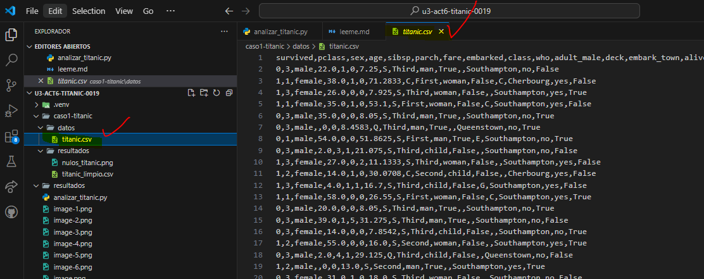
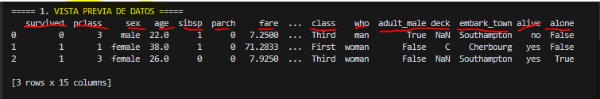
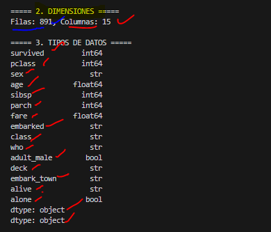
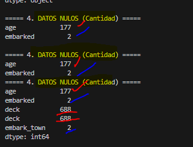
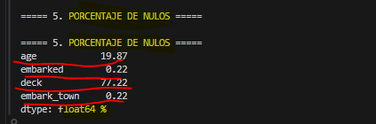
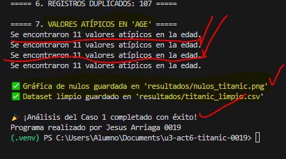
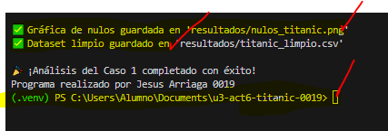
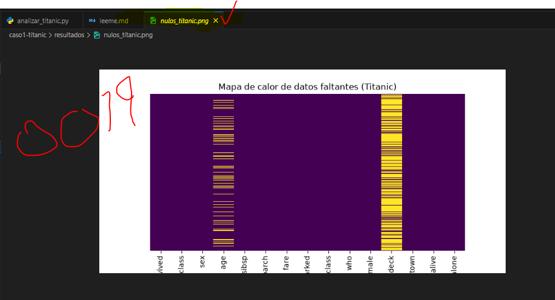

# 🕵️‍♂️ Práctica: Identificación de Problemas en los Datos

> **⏱️ Duración:** 2 horas  
> **🎯 Nivel:** Cero a principiante  
> **🤖 Área:** Machine Learning (Data Cleaning)  
> **💻 Herramientas:** Python, VS Code, Pandas, NumPy, Seaborn  

---

## 🎯 Propósito de la Práctica
Que los estudiantes aprendan a revisar conjuntos de datos (*datasets*) e identifiquen los problemas más comunes que pueden arruinar el entrenamiento de un modelo de Machine Learning. 

Trabajaremos con dos escenarios reales:
1. **Caso 1: Pasajeros del Titanic** 🚢 (Detección de problemas reales: nulos, duplicados, tipos y atípicos).

## Archivo .csv

##  VISTA PREVIA DE DATOS

 ### DIMENSIONES y tipos de datos 
 
 ### Datos nulos 
 
 ## POrcentajes nulos 
 
 ##  VALORES ATÍPICOS EN 'AGE'
 
 ## LImpieza y ejecucion completa 
 
 ## Imagen generada 
 
